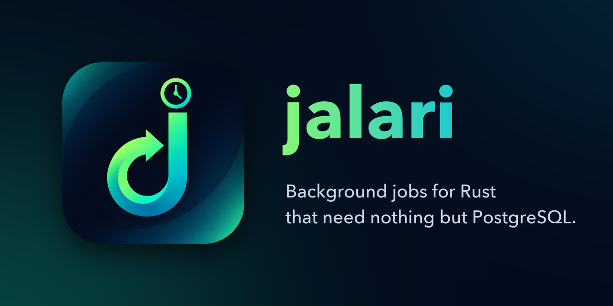

<p align="center">
  
</p>

<p align="center">
  <a href="https://crates.io/crates/jalari"></a>
  <a href="https://docs.rs/jalari"></a>
  <a href="https://github.com/MengXi47/jalari/actions/workflows/rust.yml"></a>
  <a href="#license"></a>
  <a href="https://www.rust-lang.org"></a>
  <a href="https://www.postgresql.org"></a>
</p>

jalari keeps jobs, schedules and workers in PostgreSQL tables. Declare a job with
`#[jalari::job]`, enqueue it from anywhere, and run as many workers as you need.

```toml
[dependencies]
jalari = "0.7"
```

## Features

- **Jobs** — immediate or delayed, enqueued alone, thousands at once with `enqueue_many`, or
  inside your own transaction; name, queue, attempts, timeout and priority declared in
  `#[jalari::job(..)]`.
- **Follow-up jobs** — `enqueue_on_success` enqueues the next job only when the current
  attempt succeeds, in the same statement, and jobs record the job that enqueued them.
- **Priority and expiry** — four priority levels per job type or per job, and jobs that are
  discarded if they are still waiting past their deadline.
- **Cron and intervals** — cron schedules declared in code, plus cron or every-N-units
  schedules added, changed and removed at runtime, with time zones, daylight saving and end
  conditions (`until`, `max_runs`) handled.
- **Deduplication and exclusion** — `job_key` keeps one job per key; `queue_key` keeps jobs
  with the same key from running at once, or lets up to a set number run.
- **Retries** — exponential backoff with jitter, per job type or per worker, `retry_after` for
  rate limits, permanent errors, timeouts, and panics isolated to the job that caused them.
- **Snooze and discard** — a job can ask to run again later without using an attempt, or end
  itself without counting as a failure.
- **Named queues** — each worker chooses its queues and how many jobs run at once; pause and
  resume a queue across every worker.
- **Context and middleware** — capture a tenant or user when enqueuing and rebuild it on the
  worker with your own middleware; jobs declare what they need and workers check it at startup,
  and middleware hears how each attempt ended.
- **Stop, restart and cancel** — stop a job to free everything it holds, restart it later from
  the progress it saved at its last checkpoint, or cancel it for good; `interrupted()` reaches
  a job blocked in a long `.await`.
- **Graceful shutdown** — running jobs finish, or go back to their queue at their next
  checkpoint, before a worker exits.
- **Code fingerprints** — opt in per job to stamp it with a hash of the code it reaches, so a
  worker runs it only when the worker was built from the same code.
- **Renaming** — `aliases` keep the jobs and schedules stored under a job's old name running.
- **Through your own crate** — a crate that re-exports jalari lets the crates that depend on it
  define jobs without depending on jalari themselves, through `crate = "..."` in
  `#[jalari::job(..)]`; see
  [Using jalari through another crate](docs/guide.md#using-jalari-through-another-crate).
- **Monitoring and management** — a live list of workers, counts and throughput per queue,
  job listing by state, priority, queue, key, time, tenant context or parent job, each job's
  history, retrying failed jobs, running scheduled ones now and moving waiting ones to another
  priority; optional deletion of finished jobs.
- **Table setup your way** — from code, with the `jalari` CLI, or as SQL for your own
  migrations.

## How it works

```
   Your app                Schedules
  ┌───────────────┐      ┌───────────────┐
  │ enqueue a job │      │ a run is due  │
  └───────┬───────┘      └───────┬───────┘
          └──────────┬───────────┘
                     ▼
        ┌─────────────────────────┐
        │       PostgreSQL        │
        │   jobs wait in a table  │
        └────────────┬────────────┘
                     │  wake a worker, it claims the next due job
                     ▼
        ┌─────────────────────────┐
        │         Workers         │
        │ run it, save the result │
        └─────────────────────────┘
```

Every job moves through the same states:

```
  waiting ──▶ running ──▶ succeeded
   │  ▲          │
   │  └─ retry ◀─┤  attempt failed with attempts left, or the job snoozed
   │             ├──▶ failed      out of attempts, or an error that retrying cannot fix
   │             └──▶ discarded   the job gave up on purpose
   └────────────────▶ discarded   still waiting when it expired
```

- A worker marks the job it takes as running under its own name until the job is done, so no
  one else can take it in the meantime.
- Workers wake up the moment a job arrives, and check on their own from time to time in case
  a wake-up is missed.
- When a schedule is due, its job is created and the schedule moves to its next time in one
  step, so a run is never lost or doubled.

## Multiple workers

```
   ┌ web × N ┐      ┌ worker A ┐  ┌ worker B ┐  ┌ worker C ┐
   │ enqueue │      │ emails   │  │ emails   │  │ reports  │
   └────┬────┘      │ scheduler│  │ scheduler│  │          │
        │           └────┬─────┘  └────┬─────┘  └────┬─────┘
        └────────────────┴──────┬──────┴─────────────┘
                                ▼
                           PostgreSQL
```

- **Add capacity by starting processes.** Workers coordinate only through the database and
  need no configuration to find each other.
- **No job runs twice at once.** A running job is a `running` row that names its worker.
  A worker that loses its database connection aborts its jobs before any other worker can
  take them over, and a worker that was frozen aborts them the moment it wakes up.
- **Crashes recover on their own.** When a worker dies, another worker runs its jobs again
  from their saved progress 6 to 13 seconds later, depending on how it died. A running job
  holds no connection or transaction, so the pool stays small and VACUUM is never held back.
- **Each scheduled run is enqueued once**, however many workers run the scheduler. If one
  stops, the others keep schedules firing.
- **Run workers where you like** — inside your web server, or as separate binaries that serve
  different queues.

Jobs run at least once: a job interrupted by a crash runs again, so make it idempotent. An
interrupted run still counts as an attempt, so a job that keeps crashing its worker is marked
failed once it runs out of attempts.

## Example

```rust
use jalari::{Job, JobResult};
use serde::{Deserialize, Serialize};

#[derive(Serialize, Deserialize)]
struct SendEmail {
    to: String,
}

#[jalari::job(name = "send_email", queue = "emails")]
impl Job for SendEmail {
    async fn run(self) -> JobResult {
        println!("sending to {}", self.to);
        Ok(())
    }
}

jalari::init(pool).migrate().await?;
jalari::enqueue(&SendEmail { to: "ada@example.com".into() }).await?;

let worker = jalari::Worker::builder().queue("emails", 4).build().await?;
worker.run(shutdown).await;
```

## Documentation

- [Guide](docs/guide.md) — setup, jobs, enqueueing, schedules, workers, stopping and
  restarting, middleware, deployment and settings
- [Examples](docs/guide.md#examples) — complete programs: a tour of the basics, every way an
  attempt ends, priorities, key limits, paused queues and job trees, stopping and restarting
  with checkpoints, middleware and context, and split web, worker and control binaries
- [Contributing](CONTRIBUTING.md)

## License

Licensed under either of [Apache License, Version 2.0](LICENSE-APACHE) or
[MIT license](LICENSE-MIT) at your option.
